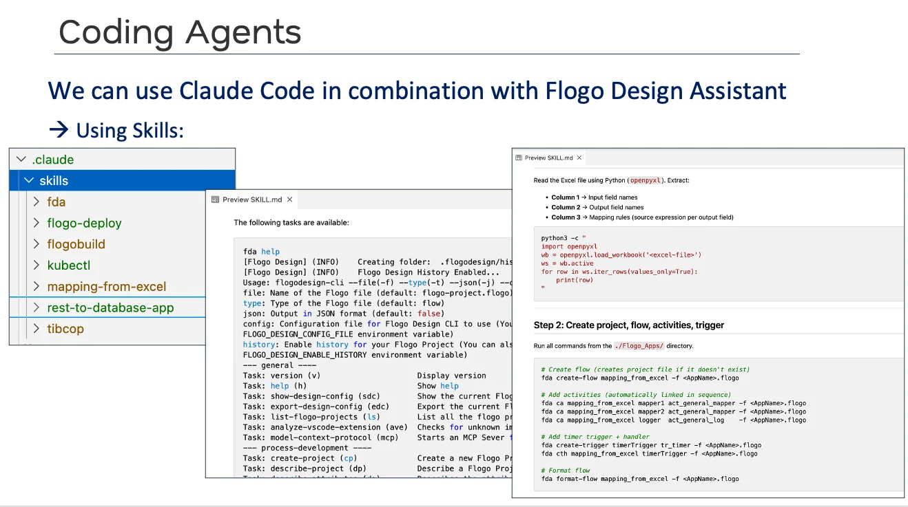
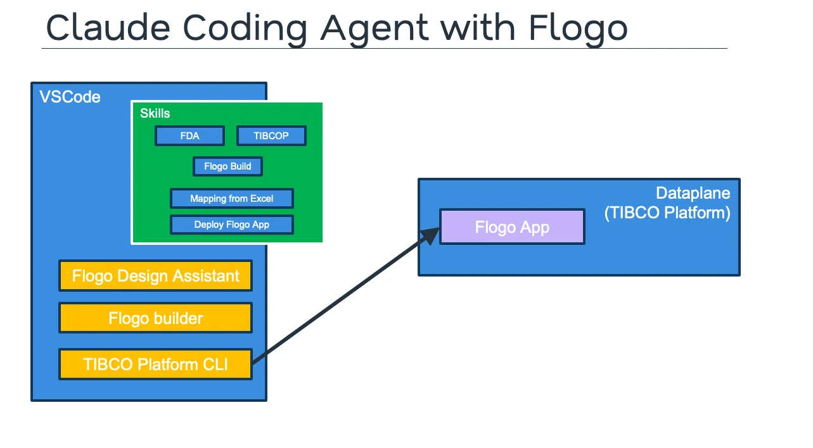
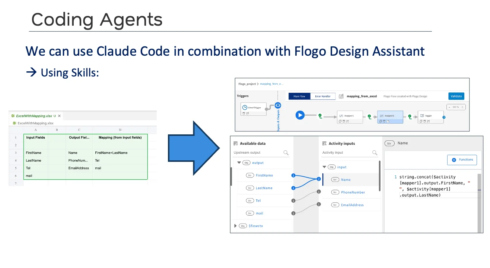
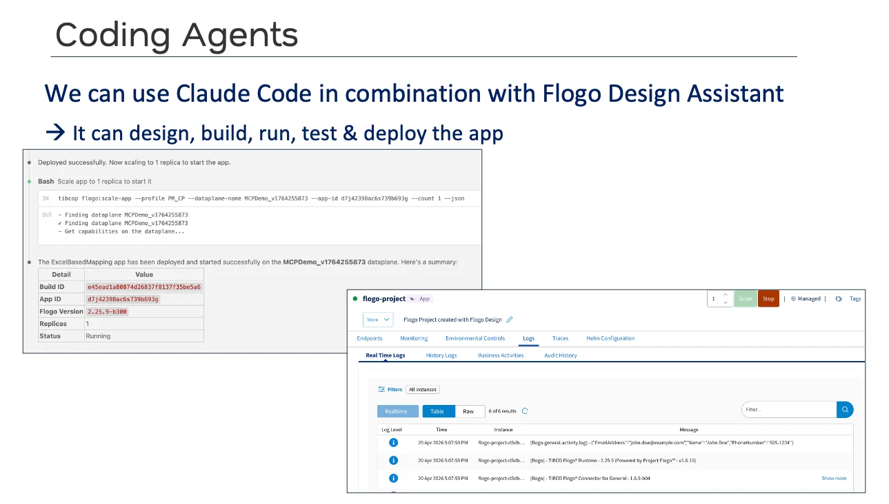
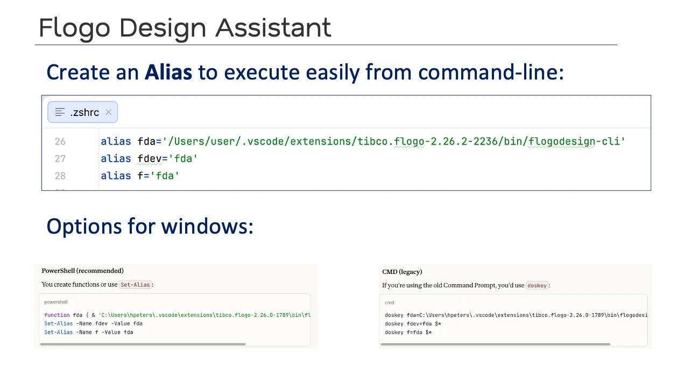

# Flogo Skill Library

A library of **skills for AI coding agents** to design, build, test, and deploy TIBCO Flogo integration applications. The skills are plain Markdown instruction files, so they work with any agentic coding assistant that supports skills — including **Claude Code**, **GitHub Copilot**, and **AWS Kiro**. Add them to the `.claude/skills/` directory of your project and the assistant uses them to drive the Flogo design, build, and platform CLIs end-to-end.

The library also includes the **Agentic AI Use Case Builder**: describe an agentic AI use case in plain English and your coding assistant designs, builds, and tests a **governed** Flogo agentic app for you — no hand-coding of flows.

## Watch: Build Integration Workflows in Minutes

See the skills in action — designing, building and deploying a Flogo application with an AI coding agent.

<div style="position:relative;padding-top:56.25%;max-width:880px;margin:1.5rem auto;">
  <a href="https://www.youtube.com/watch?v=bxucbxwSBPc"></a>
  <iframe
    src="https://www.youtube.com/embed/bxucbxwSBPc"
    title="Build Integration workflows in minutes with AI Coding Agents &amp; Skills"
    loading="lazy"
    style="position:absolute;top:0;left:0;width:100%;height:100%;border:0;border-radius:8px;"
  ></iframe>
</div>

<p style="text-align:center;"><a href="https://www.youtube.com/watch?v=bxucbxwSBPc">Watch on YouTube</a></p>

---

## Run the Flogo Skill Library Template

[Open the Flogo Skill Library Template](/tibco/hub/create/templates/default/flogo-skill-library-template) to scaffold a new project pre-seeded with the skills, the `AGENT.md` / `CLAUDE.md` project conventions for your coding agent, a `config.example.md` for your environment settings, and the library documentation.

---

## What's a Skill?

A **skill** is a Markdown file with frontmatter that documents a specific capability for an AI coding agent. The agent reads the skill on demand when the user's request matches its description. Skills make the agent reliable and repeatable on domain-specific tasks (like building a Flogo flow) — without you having to explain the same patterns over and over.

Each skill in this library lives in `.claude/skills/<skill-name>/SKILL.md` and follows this shape:

```markdown
---
name: <skill-name>
description: <when the agent should use this skill>
user-invocable: true
---

# Step-by-step instructions, command references, and recipes...
```



---

## What's in this Library

The library contains **9 skills** that cover the full Flogo development lifecycle — from designing a flow, to mapping and testing it, to building an executable, to deploying it on the TIBCO Platform, and up to building complete Agentic AI use cases.

| Skill | Type | Purpose |
|---|---|---|
| **fda** | CLI reference | Full reference for the **Flogo Design Assistant** CLI — every task to create or modify a `.flogo` file (flows, activities, triggers, schemas, properties, tests). |
| **fda-mapping** | CLI reference | Focused reference for **building, inspecting, and validating Flogo mappings** with `fda` — the four source kinds (`$flowctx` / `$property` / `$activity` / `$loop`), function calls, and `@foreach` loops. |
| **flogobuild** | CLI reference | Reference for **building executables** and TIBCO Platform deployment artifacts from `.flogo` files. |
| **tibcop** | CLI reference | Reference for the **TIBCO Platform CLI** — manage builds, deploy, scale, and inspect Flogo applications on a dataplane. |
| **flogo-deploy** | Recipe | End-to-end recipe to **deploy a `.flogo` app to a TIBCO Platform dataplane** (build → values → deploy → scale). |
| **flogo-unit-testing** | Recipe | Recipe to **create and run unit tests for Flogo apps** — test cases with flow inputs, assertions on flow outputs, and test execution with result verification. |
| **mapping-from-excel** | Recipe | Recipe to **build a Flogo flow from an Excel mapping spec** — input fields, output fields, and per-field mapping rules. |
| **rest-to-database-app** | Recipe | Recipe to **scaffold a REST API Flogo app that queries a database** (REST trigger → log → DB query → reply). |
| **agentic-ai-use-case-builder** | Use-case builder | Build a **governed-by-default Agentic AI use case for any industry** — an MCP Server + A2A reasoning agents + a WebSocket AI Orchestrator, backed by PostgreSQL, with the business rules enforced in SQL. See [Agentic AI Use Case Builder](#agentic-ai-use-case-builder). |

### Example prompts

You rarely have to name a skill — describing the task in plain language is enough for the agent to pick the right one.

| Skill | Example prompt |
|---|---|
| **fda** | *"Add a PostgreSQL query activity to the `getOrders` flow in `orders-api.flogo` and connect it to the `OrdersDB` connection."* |
| **fda-mapping** | *"Validate the mappings in `customer-api.flogo` and fix any unresolved mapper fields."* |
| **flogobuild** | *"Build `customer-api.flogo` and run it locally for 5 seconds, then show me the logs."* |
| **tibcop** | *"List my TIBCO Platform dataplanes and show the status of the apps running on `MyDataPlane`."* |
| **flogo-deploy** | *"Deploy `Flogo_Apps/customer-api.flogo` to dataplane `MyDataPlane` and start it."* |
| **flogo-unit-testing** | *"Create and run unit tests for `books-api.flogo` — one case per flow, asserting the response code and body."* |
| **mapping-from-excel** | *"Read `ExcelWithMapping.xlsx`, create the Flogo flow, then build and run it locally for 5 seconds and show me the logs."* |
| **rest-to-database-app** | *"Create a Flogo app `customer-api` that exposes `GET /customers/{id}` and queries a MySQL database."* |
| **agentic-ai-use-case-builder** | *"Build a telecom mobile billing agentic AI use case that explains a bill and handles disputes, with refunds over $50 held for review."* |

More prompts — REST + SQL, AWS SQS, OpenAPI specs, schema mapping and more — are in the [Sample Prompts](https://github.com/TIBCOSoftware/flogo-enterprise-hub/blob/master/skills-library/SamplePrompts/README.md).

### Do the skills load automatically?

**Yes.** Every skill is marked `user-invocable: true`:

- **Auto-discovery.** The agent keeps each skill's `name` and `description` in context. When your request matches, it opens and follows that skill — ask *"deploy this app to my dataplane"* and it reaches for `flogo-deploy`.
- **Explicit invocation.** Type `/` in your coding assistant to pick a skill (for example `/agentic-ai-use-case-builder`), or name it in your prompt (*"use the fda-mapping skill to …"*). The identifier is the skill's frontmatter `name`, which matches the folder name for every skill **except two**: the `fda/` skill is named **`flogo-design-assistant`** and the `tibcop/` skill is named **`tibco-platform-cli`**.
- **What they need.** A skill only runs its CLI steps once the tools and `config.md` are set up (see [Prerequisites](#prerequisites) and [Configurable Defaults](#configurable-defaults)). Without `config.md`, the agent asks you to create it from the template first.

---

## Agentic AI Use Case Builder

The `agentic-ai-use-case-builder` skill turns a plain-English description of an agentic AI use case into a complete, runnable, **governed** Flogo solution: three Flogo apps, a PostgreSQL database with sample data, tests, demo prompts, and a customer-facing README.

The design rule is ***agentic in the middle, deterministic at the edges***: the AI handles the conversation and the genuinely fuzzy reasoning, PostgreSQL decides identity, scope, prices and every state change, and people decide the exceptions. Because the rules live in the database — not in the AI's instructions — the assistant cannot be talked into breaking them.

### The three-app pattern

| App | Role | Trigger |
|---|---|---|
| **`<Prefix>MCPServer`** | The **governed gateway** to the data: verified identity (session token), scoped reads, guarded two-step writes, and human-review routing — plus the staff reviewer tools. | MCP (HTTP streamable) |
| **`<Prefix>Agents`** | One to three **A2A reasoning agents** for the fuzzy step (explain a bill, decode a reason code, rank options). They are **read-only** and get only the **minimised input** they need — they never see the user's identity. | A2A (one port per agent) |
| **`<Prefix>AIOrchestrator`** | The **conversation**: understands the request, calls the MCP tools and A2A agents, asks for a yes before each change, and keeps **per-connection memory**. | WebSocket |

```
   Browser Chatbot ──ws──▶ AI Orchestrator ──▶ LLM
                                 │  ├──▶ MCP Server ──▶ PostgreSQL   (identity · scoped reads · guarded writes · review cases)
                                 │  └──▶ A2A Agents ──▶ LLM          (read-only reasoning on minimised input)
```

### Governed by default

| | Plain, ungoverned demo | **Agentic AI Use Case Builder** |
|---|---|---|
| Starting point | a domain | a domain **+ the decision framework** — every operation classified as **agent**, **deterministic**, or **human-owned** first |
| Identity | none / trust the chat | verify → **session token**; per-connection conversation |
| Reads | one tool per table | **scoped** through a SQL rule function — another customer's record is simply "not found" |
| Writes | the LLM chooses the values | **guarded** MCP tools: `INSERT … SELECT rule_fn()` writes 0 rows when blocked |
| State changes | one call | **two-step**: propose → explicit user yes → confirm (rules re-checked) |
| Exceptions | the model decides | **human-in-the-loop**: routed review cases that a staff reviewer decides in the same chatbot (team scope and approval limit enforced in SQL) |
| Done means | it compiles | a **4-step test ladder**, ending with a real chat that includes a **prompt-injection attempt** |

### How it works

1. **Describe the use case.** Invoke it with `/agentic-ai-use-case-builder` or just ask in plain language (*"build an agentic AI use case for &lt;industry&gt;"*).
2. **Answer a few questions.** It asks only about what you haven't told it — business goal, audience and region, persona and sign-in, what users look up and change, the fuzzy judgments, which requests a person must decide, the demo storyline, and the runtime LLM. Answer *"you decide"* and it drafts the answer as a listed assumption.
3. **Approve the plan.** It shows what it heard, its assumptions, which steps are done by the AI vs. the database vs. a person, and the build plan. **It builds nothing until you approve.**
4. **It builds** with one of two methods (it asks which): **from scratch with the `fda` CLI** (recommended default) or **clone-and-adapt** from an existing reference use case.
5. **It tests** with the four-step ladder:

| Step | What it proves |
|---|---|
| 1. SQL rules | Every rule works on the real database: blocked actions write nothing, users only see their own data, reviewers stay within their team and approval limit. |
| 2. Static checks | The three apps are wired correctly and follow the governance rules (no rules in prompts, scoped reads, guarded writes, complete reviewer loop, no live secrets at commit time). |
| 3. Smoke tests | The built Flogo apps enforce the same rules at the MCP edge, and each A2A agent answers. |
| 4. Chat test | A real end-to-end conversation through the chatbot — including a prompt-injection attempt — checked against the database afterwards. |

Steps 1–2 need no LLM and no executables; steps 3–4 build the apps and call your LLM, so they run only when you ask.

**What you get:** a use-case folder with `database.sql` / `seed_data.sql` / `reset_data.sql`, the three `.flogo` apps, a `README.md`, `prompts.md` (including prompts that must be refused), a sanitized chat transcript, and the `_rebuild/` scripts to regenerate and re-test the apps. Your live credentials stay in the apps so you can run them locally; it never commits unless you ask.

### Build your own — just ask your assistant

> *"Build a governed retail banking agentic AI use case where customers can check balances and transfer money, but transfers over a 20k limit need a human to approve."*
>
> *"Build a telecom mobile billing agentic AI use case that explains a bill and handles disputes, with refunds over $50 held for review."*
>
> *"Build a retail banking agentic AI use case. After a customer signs in, they can see their recent transactions, freeze a lost or stolen card, and dispute a charge they don't recognise. Anything that needs a person — a refund, a complaint, or a hardship request — should go to a staff member to approve. Make sure each customer can only ever see their own account. Then test it end to end."*

To skip most of the questions, put the answers in your first message:

```
Use the agentic-ai-use-case-builder skill to build a use case.
Business problem / audience / region: <what it should solve, who watches, country>
Persona and identity: <who chats; identifier + one-time code>
Reads: <what they look up>
Actions and their rules: <what they can change; limits, prices, what blocks it>
Fuzzy steps (1-3 A2A agents): <the genuinely semantic judgments, e.g. rank, classify, explain>
Human-owned requests: <what a person must decide, and which team>
Demo storyline: <the happy path and the "wow" moment>
Email: <yes / no>
Runtime model: gpt-5.5            # a capable tool-calling model; NOT a nano-class model
Run all four test steps, including the chat test.
```

> **Tip:** Use a capable tool-calling model (`gpt-5.5` class) for the agentic apps. Nano-class models drop tool calls and fail to delegate.

### Using the builder in a project created from the template

The builder studies (and, with the clone method, copies) the reference use cases and uses the shared browser chatbot from the [flogo-enterprise-hub](https://github.com/TIBCOSoftware/flogo-enterprise-hub) repo. You can either:

- work directly in a clone of `flogo-enterprise-hub` (open `skills-library/` as your workspace) — everything is in place; or
- in a project created from the template, clone `flogo-enterprise-hub` alongside it and set `AGENTIC_USE_CASES_DIR` in `.claude/skills/config.md` to its `samples/Agentic_AI/` folder. If the folder can't be found, the skill asks you to point to it.

---

## Agentic AI Industry Use Cases

**14 governed industry use cases across 10 verticals** were built with the Agentic AI Use Case Builder. Each follows the same three-app pattern, enforces its rules in SQL, and was tested end to end — including prompt injection. Spin up a credible, industry-specific agentic demo quickly, then adapt it to your own business.

| Industry | Use case |
|---|---|
| Financial Services | [Retail Banking Assistant](https://github.com/TIBCOSoftware/flogo-enterprise-hub/tree/master/samples/Agentic_AI/Industry_Use_Cases/Financial_Services/Banking/Retail_Banking_Assistant_Use_Case) · [Corporate Payments Investigation](https://github.com/TIBCOSoftware/flogo-enterprise-hub/tree/master/samples/Agentic_AI/Industry_Use_Cases/Financial_Services/Banking/Corporate_Payments_Investigation_Use_Case) |
| Insurance | [Auto Policy & Claims (RAG)](https://github.com/TIBCOSoftware/flogo-enterprise-hub/tree/master/samples/Agentic_AI/Industry_Use_Cases/Insurance/PC_Multi_Line/Auto_Insurance_Policy_Claims_RAG_Use_Case) · [Life & Pensions Member Services](https://github.com/TIBCOSoftware/flogo-enterprise-hub/tree/master/samples/Agentic_AI/Industry_Use_Cases/Insurance/Life_Pensions_Wealth/Life_Pensions_Member_Services_Use_Case) |
| Telecom | [Mobile Billing & Spend Control](https://github.com/TIBCOSoftware/flogo-enterprise-hub/tree/master/samples/Agentic_AI/Industry_Use_Cases/Telecommunications/Mobile_Fixed_Cable_Operators/Telecom_Mobile_Billing_Use_Case) |
| Energy & Utilities | [Electric Outage & Billing](https://github.com/TIBCOSoftware/flogo-enterprise-hub/tree/master/samples/Agentic_AI/Industry_Use_Cases/Energy_Utilities/Electric_Gas_Utilities_Grid/Electric_Utility_Outage_Billing_Use_Case) · [Oilfield Asset Health Monitoring](https://github.com/TIBCOSoftware/flogo-enterprise-hub/tree/master/samples/Agentic_AI/Industry_Use_Cases/Energy_Utilities/Oil_Gas/Oilfield_Asset_Health_Monitoring_Use_Case) |
| Healthcare | [Hospital Post-Discharge Care](https://github.com/TIBCOSoftware/flogo-enterprise-hub/tree/master/samples/Agentic_AI/Industry_Use_Cases/Healthcare_Life_Sciences/Providers_Health_Systems/Hospital_Post_Discharge_Care_Use_Case) |
| Aerospace & Defense | [MRO AOG Operations](https://github.com/TIBCOSoftware/flogo-enterprise-hub/tree/master/samples/Agentic_AI/Industry_Use_Cases/Aerospace_Defense/Defense_Space/Aerospace_MRO_AOG_Operations_Use_Case) |
| High Tech | [Semiconductor Orders & RMA](https://github.com/TIBCOSoftware/flogo-enterprise-hub/tree/master/samples/Agentic_AI/Industry_Use_Cases/High_Tech_Software/Semiconductors_Electronics/Semiconductor_Orders_RMA_Use_Case) |
| Real Estate | [Lead Engagement](https://github.com/TIBCOSoftware/flogo-enterprise-hub/tree/master/samples/Agentic_AI/Industry_Use_Cases/Real_Estate/Residential_Brokerage/Real_Estate_Lead_Engagement_Use_Case) |
| Media | [Scholarly Publishing Author Services](https://github.com/TIBCOSoftware/flogo-enterprise-hub/tree/master/samples/Agentic_AI/Industry_Use_Cases/Media_Travel/Media_Publishing/Scholarly_Publishing_Author_Services_Use_Case) |
| Transportation & Logistics | [Airline Passenger Services](https://github.com/TIBCOSoftware/flogo-enterprise-hub/tree/master/samples/Agentic_AI/Industry_Use_Cases/Transportation_Logistics/Airlines_Aviation/Airline_Passenger_Services_Use_Case) · [Parcel Delivery](https://github.com/TIBCOSoftware/flogo-enterprise-hub/tree/master/samples/Agentic_AI/Industry_Use_Cases/Transportation_Logistics/Parcel_Postal_Logistics/Parcel_Delivery_Last_Mile_Use_Case) |

The full catalog, with what each use case does, is in the [Industry Use Cases README](https://github.com/TIBCOSoftware/flogo-enterprise-hub/blob/master/samples/Agentic_AI/Industry_Use_Cases/README.md).

**BW6 + Flogo "Better Together":** the [Retail — BW & Flogo](https://github.com/TIBCOSoftware/flogo-enterprise-hub/tree/master/samples/Agentic_AI/BW6_Flogo_Samples/Retail_AI_BW_Flogo) sample shows BW6 serving the domain APIs through an MCP Server, while a single Flogo **LLM Client** activity does all the AI orchestration as an agentic layer on top of the BW6 services. (This sample is not built with the skill and needs a BW6 runtime.)

### Try it in about 15 minutes

1. Clone [flogo-enterprise-hub](https://github.com/TIBCOSoftware/flogo-enterprise-hub) and open it in VS Code with the **TIBCO Flogo extension 2.26.7 or later**.
2. Run the one-command setup — it checks prerequisites, loads the demo database, and builds the apps (you need PostgreSQL and an LLM API key to run them):

    ```bash
    python samples/Agentic_AI/Industry_Use_Cases/setup.py --list            # list the use cases
    python samples/Agentic_AI/Industry_Use_Cases/setup.py <Use_Case_folder>
    ```

3. Follow [RUNNING_THE_SAMPLES.md](https://github.com/TIBCOSoftware/flogo-enterprise-hub/blob/master/samples/Agentic_AI/Industry_Use_Cases/RUNNING_THE_SAMPLES.md) to start the apps (MCP Server → Agents → Orchestrator) and chat with them in the browser chatbot.

---

## Architecture: Coding Agent + Flogo

The skills work alongside the rest of the Flogo developer toolkit. The coding agent uses **VS Code with the Flogo Design Assistant** for design-time editing, **flogobuild** for local builds, and the **TIBCO Platform CLI (`tibcop`)** to deploy applications to a dataplane on the TIBCO Platform.



---

## Example: Excel-to-Flogo Mapping

Using the `mapping-from-excel` skill, the agent can read an Excel mapping spec — input fields in column A, output fields in column B, and a mapping expression in column C — and turn it into a fully wired Flogo flow with two mappers, a logger, and a timer trigger. Projects created from the template include the `ExcelWithMapping.xlsx` sample.



A typical prompt:

> *"Read `ExcelWithMapping.xlsx` and create a Flogo flow that performs the mapping defined in the spreadsheet. Then build it and run it locally for 5 seconds and show me the logs."*

---

## Example: Design, Build, Run, and Deploy

The `flogo-deploy` skill chains together the build (`flogobuild`), values generation, deployment (`tibcop flogo:deploy-app-release`), and scale-up (`tibcop flogo:scale-app`) steps. The agent can take an app from source to a running instance on the TIBCO Platform in a single conversation.



A typical prompt:

> *"Deploy the `Flogo_Apps/customer-api.flogo` app to dataplane `<DATAPLANE_NAME>` and start it."*

---

## Getting Started

### Option 1: Install via the Marketplace template

1. Open the **Flogo Skill Library** entry in the TIBCO Developer Hub Marketplace.
2. Click **Get** to install the documentation.
3. Open [the Flogo Skill Library Template](/tibco/hub/create/templates/default/flogo-skill-library-template) to generate a new project pre-seeded with the skills.
4. Open the generated GitHub repo in **VS Code** with your coding assistant (Claude Code, GitHub Copilot, AWS Kiro, …).
5. Copy `.claude/skills/config.example.md` to `.claude/skills/config.md` and fill in the values for your environment (see [Configurable Defaults](#configurable-defaults)). The agent conventions live in `AGENT.md` (imported by `CLAUDE.md`).
6. Run the preflight check (see [Prerequisites](#prerequisites)), then start asking the agent to design, build, run, or deploy Flogo apps — or to build an agentic AI use case.

> **What's committed:** the generated project includes a `.gitignore` that keeps `.claude/skills/config.md` (your credentials), build output, and the `Flogo_Apps/` working folder out of Git — `.flogo` files there can have live secrets baked into their property values. Remove the `Flogo_Apps/` line once you are ready to commit apps whose secrets you have replaced with placeholders.

### Option 2: Add skills to an existing project

If you already have a project, copy the `.claude/skills/` folder and `AGENT.md` (plus `CLAUDE.md` if you use Claude Code) from the [skills-library](https://github.com/TIBCOSoftware/flogo-enterprise-hub/tree/master/skills-library) into your project root, then create `.claude/skills/config.md` from `config.example.md`. Make sure `.claude/skills/config.md` is git-ignored.

---

## Prerequisites

You only need the tools for what you ask the agent to do:

| Tier | You want to… | You need |
|---|---|---|
| **1. Design** (always) | design and edit `.flogo` apps | **VS Code + [TIBCO Flogo extension](https://www.tibco.com/downloads/11810) 2.26.7+** — it ships `fda`, nothing separate to install |
| **2. Agentic use cases** | use the Agentic AI Use Case Builder | **PostgreSQL 14+** with `psql`, **Python 3.9+**, and an **LLM API key** for a capable tool-calling model |
| **3. Build** | build executables, run unit tests, chat end-to-end | **`flogobuild`** (Flogo App Build CLI) + a build context, the **Go runtime 1.25.7+**; for the chat test also **Node.js 16+** and `pip install websocket-client` |
| **4. Deploy** | deploy to the TIBCO Platform | **`tibcop`** (TIBCO Platform CLI) + a profile and a TIBCO Platform account |

Downloads: the Flogo VS Code extension and `flogobuild` are on the [TIBCO downloads page](https://www.tibco.com/downloads/11810) (`flogobuild` is **not** bundled in the extension); `tibcop` is on the [TIBCO Platform CLI download page](https://www.tibco.com/downloads/12464); Go is at [go.dev/dl](https://go.dev/dl/). Create the build context from the extension `.vsix`:

```bash
flogobuild create-context -n <name-without-dots> -v <path-to-flogo-extension.vsix> --set-default
```

**Run the preflight first.** It checks only the tiers you ask for, prints the exact install hint for anything missing, and works on Windows, macOS, and Linux (paths shown for a project created from the template; in the `flogo-enterprise-hub` repo prefix them with `skills-library/`):

```bash
python .claude/skills/agentic-ai-use-case-builder/templates/preflight.py                    # design only
python .claude/skills/agentic-ai-use-case-builder/templates/preflight.py --need db          # + agentic use cases
python .claude/skills/agentic-ai-use-case-builder/templates/preflight.py --need build,chat  # + build / chat test
python .claude/skills/agentic-ai-use-case-builder/templates/preflight.py --need deploy      # + deploy
```

The full tiered table — versions, connector prerequisites, licence file, Git Bash on Windows, SMTP — is in [AGENT.md → Prerequisites and preflight](https://github.com/TIBCOSoftware/flogo-enterprise-hub/blob/master/skills-library/AGENT.md#prerequisites-and-preflight).

---

## Setting up the `fda` alias

The Flogo Design Assistant CLI (`flogodesign-cli`) ships inside the TIBCO Flogo VS Code extension at a versioned path like `<vscode-extensions-dir>/tibco.flogo-<VERSION>/bin/flogodesign-cli`. Give it a short name — `fda` — so you (and the coding agent) can simply run `fda <task>` from any terminal. There are two ways to do this:

| | Option 1 — Alias | Option 2 — Auto-discovery function |
|---|---|---|
| **How it works** | Points at the exact `flogodesign-cli` path you choose | Looks up the newest installed `tibco.flogo-*` extension on every call |
| **Pros** | Simple, explicit, you control exactly which version runs | Keeps working after Flogo extension updates — nothing to edit |
| **After an extension update** | Change `<VERSION>` in the alias to the new folder | No action needed |
| **Shells** | zsh, bash, PowerShell, Command Prompt | zsh, bash (incl. Git Bash), PowerShell |

Shell startup files:

| OS | Shell | Startup file |
|---|---|---|
| macOS | zsh (default) | `~/.zshrc` |
| Linux | bash | `~/.bashrc` |
| Windows | PowerShell | `$PROFILE` |
| Windows | Git Bash | `~/.bashrc` |

### Option 1 — Alias



#### Find the path to `flogodesign-cli`

The exact path depends on your OS, your username, and the installed Flogo extension version:

| OS | Typical path |
|---|---|
| macOS / Linux | `/Users/<USERNAME>/.vscode/extensions/tibco.flogo-<VERSION>/bin/flogodesign-cli` |
| Windows | `C:\Users\<USERNAME>\.vscode\extensions\tibco.flogo-<VERSION>\bin\flogodesign-cli.exe` |

> **Tip:** List installed extension versions with `ls ~/.vscode/extensions | grep tibco.flogo` (macOS/Linux), `Get-ChildItem $env:USERPROFILE\.vscode\extensions -Filter tibco.flogo-*` (PowerShell) or `dir %USERPROFILE%\.vscode\extensions | findstr tibco.flogo` (Command Prompt). If more than one version is listed, use the newest.

#### macOS / Linux (zsh or bash)

Add the alias to your shell startup file — `~/.zshrc` for zsh (the macOS default) or `~/.bashrc` for bash:

```bash
# ~/.zshrc  or  ~/.bashrc
alias fda='/Users/<USERNAME>/.vscode/extensions/tibco.flogo-<VERSION>/bin/flogodesign-cli'

# Optional shorter aliases
alias fdev='fda'
alias f='fda'
```

Reload the shell so the alias takes effect:

```bash
source ~/.zshrc   # or: source ~/.bashrc
```

#### Windows — PowerShell

PowerShell aliases cannot accept arguments, so define `fda` as a **function** and use `Set-Alias` for the shorter names. Add to your PowerShell profile (`$PROFILE`):

```powershell
function fda { & 'C:\Users\<USERNAME>\.vscode\extensions\tibco.flogo-<VERSION>\bin\flogodesign-cli.exe' @args }
Set-Alias -Name fdev -Value fda
Set-Alias -Name f    -Value fda
```

Open (or first create) your profile, then reload it:

```powershell
New-Item -Type File -Path $PROFILE -Force   # only if it doesn't exist yet
notepad $PROFILE
. $PROFILE
```

#### Windows — Command Prompt (legacy)

If you're using the classic `cmd.exe`, use `doskey`. Note that `doskey` macros only live in the current session — to make them permanent, save the commands in a `.cmd` file and register it via `HKCU\Software\Microsoft\Command Processor\AutoRun`.

```cmd
doskey fda=C:\Users\<USERNAME>\.vscode\extensions\tibco.flogo-<VERSION>\bin\flogodesign-cli.exe $*
doskey fdev=fda $*
doskey f=fda $*
```

The trailing `$*` forwards all arguments to the underlying command.

> **After updating the Flogo VS Code extension**, the version folder changes. Update `<VERSION>` in your alias (or switch to Option 2) — otherwise `fda` keeps calling the old version, or fails once VS Code removes the old folder.

### Option 2 — Auto-discovery function

Instead of hardcoding the path, define an `fda` function that **finds the latest installed extension version dynamically** each time it runs.

#### macOS / Linux / Windows (Git Bash) — zsh or bash

Add to `~/.zshrc` or `~/.bashrc`:

```bash
fda() {
  local cmd="" home_dir="${HOME:-$USERPROFILE}" ext_name="flogodesign-cli"
  if [[ "$OSTYPE" == "msys" || "$OSTYPE" == "cygwin" || "$OSTYPE" == "win32" ]]; then
    ext_name="flogodesign-cli.exe"
  fi
  for dir in "$home_dir/.vscode/extensions" \
             "$home_dir/.vscode-insiders/extensions" \
             "$home_dir/.vscode-server/extensions"; do
    cmd=$(ls -td "$dir/tibco.flogo-"*/bin/"$ext_name" 2>/dev/null | head -1)
    [ -n "$cmd" ] && break
  done
  if [ -z "$cmd" ]; then
    echo "Error: flogodesign-cli not found. Install the TIBCO Flogo VS Code extension." >&2
    return 1
  fi
  "$cmd" "$@"
}
```

Reload the shell so the function takes effect:

```bash
source ~/.zshrc   # or: source ~/.bashrc
```

#### Windows — PowerShell

Add to your PowerShell profile (`$PROFILE`, create it as shown in Option 1 if needed):

```powershell
function fda {
  $cli = Get-ChildItem "$env:USERPROFILE\.vscode\extensions\tibco.flogo-*\bin\flogodesign-cli.exe" -ErrorAction SilentlyContinue |
         Sort-Object LastWriteTime -Descending | Select-Object -First 1
  if (-not $cli) {
    $cli = Get-ChildItem "$env:USERPROFILE\.vscode-insiders\extensions\tibco.flogo-*\bin\flogodesign-cli.exe" -ErrorAction SilentlyContinue |
           Sort-Object LastWriteTime -Descending | Select-Object -First 1
  }
  if (-not $cli) { Write-Error "flogodesign-cli not found. Install the TIBCO Flogo VS Code extension."; return }
  & $cli.FullName @args
}
```

Reload it with `. $PROFILE`.

### PowerShell: "running scripts is disabled"

If PowerShell reports that *running scripts is disabled on this system* when loading your profile (either option), allow your own profile to load (one-time, current user only):

```powershell
Set-ExecutionPolicy -Scope CurrentUser RemoteSigned
```

### Verify

Whichever option you chose, open a new terminal and run:

```bash
fda version
```

---

## Configurable Defaults

All environment-specific values live in a **single source of truth**: `.claude/skills/config.md`. Create it from the template — it is git-ignored, so real credentials are never committed:

```bash
cp .claude/skills/config.example.md .claude/skills/config.md
```

Key values the skills rely on:

| Key (in `config.md`) | What to set it to | How to find the value |
|---|---|---|
| `FLOGOBUILD_CONTEXT_NAME` | Build context name for `flogobuild` (letters, digits, `_`, `-`; 3–30 chars; no dots) | `flogobuild list-context` |
| `DATAPLANE_NAME` | Default dataplane to deploy to | `tibcop tplatform:list-data-planes` |
| `CP_URL` / `TIBCOP_TOKEN` | TIBCO Platform control-plane URL and API token | TIBCO Platform console |
| `TIBCOP_PROFILE` | `tibcop` profile used by `flogo-deploy` | `tibcop list-profiles` |
| `FLOGO_APPS_DIR` | Folder for new `.flogo` apps, relative to `config.md` (default `../../Flogo_Apps` → `Flogo_Apps/` at the project root) | — |
| PostgreSQL / LLM / email | Connection settings for the database, LLM provider and model, and SMTP | your environment |
| `AGENTIC_USE_CASES_DIR` | *(optional)* folder of reference Agentic AI use cases the builder studies/clones | leave unset inside `flogo-enterprise-hub`; see [Using the builder in a project created from the template](#using-the-builder-in-a-project-created-from-the-template) |

---

## Tips for Working with the Agent

- **Be explicit about file paths.** The agent works best when you tell it where to put the `.flogo` file (e.g. `Flogo_Apps/customer-api.flogo`).
- **Iterate in small steps.** Ask for a flow first, then add activities, then add the trigger, then build & test.
- **Always run a local test before deploying.** The `mapping-from-excel` and `rest-to-database-app` recipes both include a build + 5-second-run step, and `flogo-unit-testing` adds repeatable assertions.
- **Let the agent use `fda`.** Structural changes to a `.flogo` file should go through `fda`, not hand edits — and never edit a `.flogo` that is open in the designer.
- **Check the agent's commands.** If the agent does something unexpected, ask it to explain which skill it used and which command it ran.


[Open Template to Create a new Project with Flogo Skills](/tibco/hub/create/templates/default/flogo-skill-library-template)
