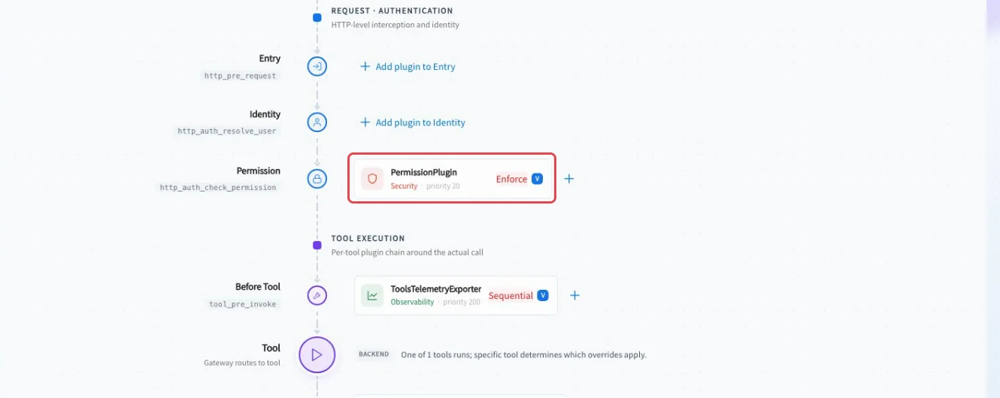
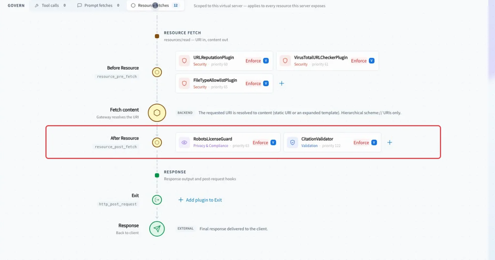
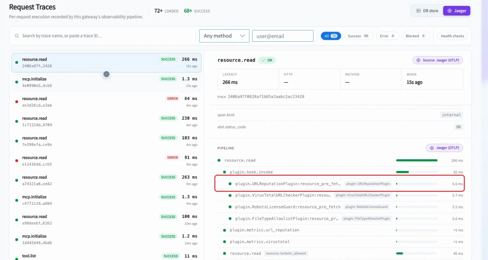
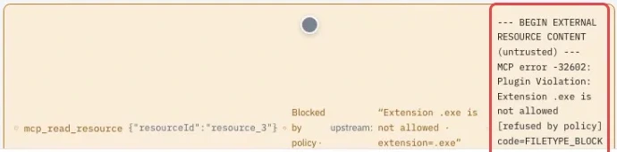
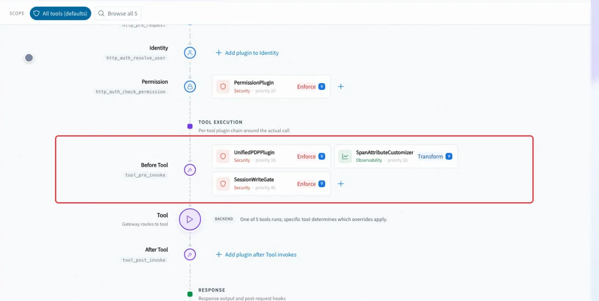
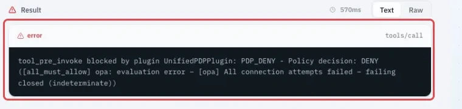
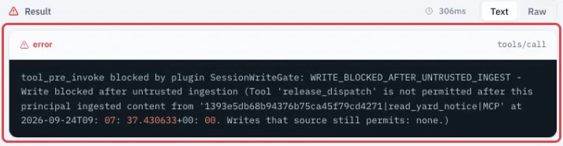

# Business compositions — several plugins, one business outcome

Business controls rarely live in one plugin. A support desk needs identity, masking and evidence; an operations desk needs bounded retries and a stop condition; a fulfillment workflow needs identity, policy and a write interlock to agree before a state change proceeds. These examples show how TIBCO MCP Hub composes plugins on one Virtual Server, how the gateway runs them in [pipeline order](plugin-pipeline.md), and what an operator sees when the combined control allows, refuses or records a call.

In every composition below, one assignment activates the plugin on every hook it declares; the lane you choose is where the Hub shows it. Attaching the same plugin a second time on the same Virtual Server merges into one policy. Tool and server names in the examples are illustrative; use the federated `<server>-<tool>` names your Virtual Server exposes.

| Composition | Business scenario | Full stack | Hook(s) | What it proves |
|---|---|---|---|---|
| Safe customer support | Retail-bank support record access for agents and trainees | [PermissionPlugin](policies-access.md), [ToolsTelemetryExporter](policies-observability.md), [PIIFilterPlugin](policies-data-protection.md), [PrivacyNoticeInjector](policies-data-protection.md) | Permission, Before Tool, After Tool, Prompt Post Fetch | The same endpoint can allow the right role, mask sensitive fields, attach a privacy notice to prompt reads and record spans. |
| Outage containment | Plant or grid incident service during a backend outage | [CircuitBreaker](policies-reliability-cost.md), [Watchdog](policies-reliability-cost.md), [RetryWithBackoffPlugin](policies-reliability-cost.md), [ToolsTelemetryExporter](policies-observability.md) | Before Tool, After Tool | A retry can recover a transient error, a breaker can stop repeated failures, and a watchdog can label slow work without pretending it stopped the backend. |
| Trusted knowledge intake | Claims desk importing outside guidance | [URLReputationPlugin](policies-content-safety.md), [VirusTotalURLCheckerPlugin](policies-content-safety.md), [RobotsLicenseGuard](policies-content-safety.md), [FileTypeAllowlistPlugin](policies-data-protection.md), [CitationValidator](policies-content-safety.md) | Resource Pre Fetch, Resource Post Fetch | Outside content must pass destination, reputation, file type, reuse and citation checks before it reaches the agent. |
| Safe data operations | Analytics assistant running generated data operations | [ArgumentNormalizer](policies-validation.md), [SQLSanitizer](policies-content-safety.md), [SchemaGuardPlugin](policies-validation.md), [CodeSafetyLinterPlugin](policies-content-safety.md) | Before Tool, After Tool | Destructive SQL, stale schemas and unsafe code are stopped at the gateway instead of relying on a prompt. |
| Controlled fulfillment | Dispatch assistant releasing shipments | [PermissionPlugin](policies-access.md), [UnifiedPDPPlugin](policies-access.md), [SessionWriteGate](policies-access.md), [SpanAttributeCustomizer](policies-observability.md) | Permission, Before Tool, After Tool | A state-changing release proceeds only when identity, external policy and read/write interlock allow it; traces explain the allowed path. |

## Safe customer support — one support endpoint, four controls

> “Two people can see the same assistant, but only one role may read the customer record, and even that answer must be masked.”

**Example scenario.** A retail-bank support agent reads a case record while helping a customer. A trainee shadows the same queue and sees the same MCP tool in the agent surface. The bank does not want to rely on a system prompt for access control. It wants the gateway to decide who may call the tool, mask configured PII fields in an allowed result, show a privacy notice when a prompt is fetched, and leave observability evidence for the call.

**What it proves.** One Virtual Server can compose an access gate, an observability hook, a result-side data protection step and a prompt-side notice. The tool-call canvas shows the tool-call bindings, while the prompt notice lives on a different pipeline lane.

**When to use it.** Use this pattern when the same support capability is exposed to users with different roles and when allowed users still need field-level protection. Use [PermissionPlugin](policies-access.md) for whole-tool access and [PIIFilterPlugin](policies-data-protection.md) for data inside an allowed response; do not ask either one to do the other’s job.

### Where it sits

| Setting | Value |
|---|---|
| Attached to | Virtual Server |
| Pipeline order | See [Plugin pipeline](plugin-pipeline.md) |
| 1 | [PermissionPlugin](policies-access.md) — Permission lane (`http_auth_check_permission`), Block (`sequential`), priority `20` |
| 2 | [ToolsTelemetryExporter](policies-observability.md) — Before Tool lane; declares `tool_pre_invoke` and `tool_post_invoke`, `sequential`, priority `200` |
| 3 | [PIIFilterPlugin](policies-data-protection.md) — After Tool lane; declares prompt and tool pre/post hooks, Block (`sequential`), priority `50` |
| 4 | [PrivacyNoticeInjector](policies-data-protection.md) — Prompt fetches lane (`prompt_post_fetch`), Transform (`transform`), priority `90` |


*The tool pipeline shows the permission stage and the before-tool telemetry binding. The prompt notice is real, but it belongs to a separate Prompt fetches lane. The PermissionPlugin chip shows `Enforce`, the legacy mode name, which the gateway resolves to `sequential`.*

### Configuration

1. Put the support tool behind a Virtual Server that authenticates callers with bearer tokens.
2. Bind `PermissionPlugin` at the permission stage: map token groups to roles with `group_role_map`, and roles to allowed federated tool names with `roles`.
3. Bind `ToolsTelemetryExporter` on the Before Tool lane; it declares both tool hooks, so it records the attempt and the outcome.
4. Bind `PIIFilterPlugin` on the After Tool lane so the gateway can mask configured fields in the returned record. It declares both tool hooks, so it also inspects arguments.
5. Bind `PrivacyNoticeInjector` to `prompt_post_fetch` for prompt reads that need the notice.
6. Apply the bindings, **Push to Gateway**, wait for `synced`, then test an allowed agent and a denied trainee as separate calls.

```json
{
  "virtual_server": "support-records",
  "assignments": [
    {
      "plugin": "PermissionPlugin",
      "hook": "http_auth_check_permission",
      "mode": "sequential",
      "priority": 20,
      "config": {
        "claims_context_key": "jwt_claims",
        "group_claim": "groups",
        "group_role_map": {
          "support-agents": ["support"],
          "support-trainees": ["trainee"]
        },
        "roles": {
          "support": ["support-records-return-case"],
          "trainee": []
        },
        "default_decision": "deny"
      }
    },
    {
      "plugin": "ToolsTelemetryExporter",
      "hook": "tool_pre_invoke",
      "mode": "sequential",
      "priority": 200,
      "config": {
        "export_full_payload": false,
        "max_payload_bytes_size": 10000
      }
    },
    {
      "plugin": "PIIFilterPlugin",
      "hook": "tool_post_invoke",
      "mode": "sequential",
      "priority": 50,
      "config": {
        "detect_ssn": true,
        "detect_credit_card": true,
        "detect_email": true,
        "detect_phone": true,
        "block_on_detection": false,
        "default_mask_strategy": "redact",
        "redaction_text": "[PII_REDACTED]"
      }
    },
    {
      "plugin": "PrivacyNoticeInjector",
      "hook": "prompt_post_fetch",
      "mode": "transform",
      "priority": 90,
      "config": {
        "notice_text": "This prompt may contain customer information. Use it only for the active support task.",
        "placement": "append",
        "marker": "[PRIVACY]"
      }
    }
  ]
}
```

### What happens

The support agent’s call succeeds and the response replaces configured PII values with `[PII_REDACTED]`. The trainee’s separate call is refused with a permission denial for the same named tool. A prompt read receives the privacy notice on the prompt pipeline, not on the tool pipeline. Traces show the call was observed and can be correlated by the platform’s MCP session id.

### Setup tips

- Test allow first, then deny. A denial cannot also prove masking because the backend result never reaches the output hook.
- Do not expect a tool-call canvas to display `prompt_post_fetch` bindings. Check the prompt pipeline or the assignment list when auditing the full stack.
- If a trace is missing, treat that as an observability problem, not as proof that the call was refused.
- Use platform session identifiers for trace correlation. Do not depend on arbitrary caller headers being forwarded to every plugin payload.

### Considerations

`PermissionPlugin` grants or denies the whole tool. It does not remove fields from an allowed result. `PIIFilterPlugin` masks output fields, but it does not decide who may call. `PrivacyNoticeInjector` never runs on a tool call. `ToolsTelemetryExporter` creates trace evidence; it is not a billing ledger or a legal audit record.

## Outage containment — retry recovery without retry storms

> “During an incident, the agent should recover from a transient backend fault, but it must not keep hammering a failing service or wait forever.”

**Example scenario.** An operations assistant checks a plant or grid incident service. Some failures are transient and worth retrying. A sustained outage should trip a visible stop before more load reaches the backend. A slow call should be labelled as a timeout from the client’s point of view, but the team also needs to know that the backend work may already have completed.

**What it proves.** Four controls can share one tool lane while deciding different things: [CircuitBreaker](policies-reliability-cost.md) refuses during an open cooldown, [Watchdog](policies-reliability-cost.md) measures elapsed time, [RetryWithBackoffPlugin](policies-reliability-cost.md) asks the gateway to retry retryable results, and [ToolsTelemetryExporter](policies-observability.md) records the path.

**When to use it.** Use this composition for operational tools whose upstream systems can be slow or intermittently unavailable. Do not use it as a substitute for upstream capacity planning, idempotency design or transaction rollback.

### Where it sits

| Setting | Value |
|---|---|
| Attached to | Virtual Server |
| Pipeline order | See [Plugin pipeline](plugin-pipeline.md) |
| 1 | [CircuitBreaker](policies-reliability-cost.md) — declares `tool_pre_invoke` and `tool_post_invoke`, Block (`sequential`), priority `70` |
| 2 | [Watchdog](policies-reliability-cost.md) — declares `tool_pre_invoke` and `tool_post_invoke`, Block (`sequential`), priority `85` |
| 3 | [RetryWithBackoffPlugin](policies-reliability-cost.md) — declares `tool_post_invoke`, priority `170` |
| 4 | [ToolsTelemetryExporter](policies-observability.md) — declares `tool_pre_invoke` and `tool_post_invoke`, `sequential`, priority `200` |

Each row is one assignment. Plugins that declare both tool hooks run before and after the call from that single assignment.

### Configuration

1. Identify which upstream status codes are retryable and which must be returned immediately.
2. Attach the breaker once. It declares both tool hooks, so the same assignment refuses before dispatch during cooldown and records outcomes after dispatch.
3. Attach the watchdog once; it starts timing before the call and judges elapsed time after the result.
4. Attach retry, which runs after the call, once a result status exists.
5. Attach telemetry for trace evidence; it records before and after the call.

```json
{
  "virtual_server": "incident-operations",
  "assignments": [
    {
      "plugin": "CircuitBreaker",
      "hook": "tool_pre_invoke",
      "mode": "sequential",
      "priority": 70,
      "config": {
        "error_rate_threshold": 0.7,
        "window_seconds": 120,
        "min_calls": 10,
        "consecutive_failure_threshold": 3,
        "cooldown_seconds": 60
      }
    },
    {
      "plugin": "Watchdog",
      "hook": "tool_pre_invoke",
      "mode": "sequential",
      "priority": 85,
      "config": {
        "max_duration_ms": 3000,
        "action": "block"
      }
    },
    {
      "plugin": "RetryWithBackoffPlugin",
      "hook": "tool_post_invoke",
      "mode": "transform",
      "priority": 170,
      "config": {
        "max_retries": 2,
        "backoff_base_ms": 200,
        "max_backoff_ms": 5000,
        "retry_on_status": [429, 500, 502, 503, 504],
        "jitter": true
      }
    },
    {
      "plugin": "ToolsTelemetryExporter",
      "hook": "tool_pre_invoke",
      "mode": "sequential",
      "priority": 200,
      "config": {
        "export_full_payload": false,
        "max_payload_bytes_size": 10000
      }
    }
  ]
}
```

### What happens

A clean call succeeds. A transient 503 is retried and the second attempt succeeds. A non-retryable 400 returns as an error and does not open the breaker. A sustained 503 becomes three gateway dispatches for one client call when `max_retries: 2`; the breaker counts all three and opens. The next call is refused before the backend is dispatched. A call slower than `max_duration_ms` still returns after the backend finishes on both the governed and baseline endpoints, but with `action: "block"` the governed response is labelled `WATCHDOG_TIMEOUT`. `WATCHDOG_TIMEOUT` is a fixed code, not a configurable value.

### Setup tips

- Tune retry and breaker together. One client-visible call can contain multiple gateway attempts, and each failed attempt can count toward the breaker threshold.
- Run an allowed clean leg before tripping a breaker, especially in environments where the open state has a cooldown.
- Retry declares only the post-call hook; it cannot retry until a result exists.
- Use telemetry to explain the path; do not treat telemetry absence as a policy denial.

### Considerations

The breaker is process-local, scoped to the Virtual Server and tool. A second gateway replica has its own counters unless the deployment adds shared state. The watchdog judges after the work returns; it does not interrupt the upstream operation. Retry cannot shorten a hang. This composition contains the blast radius at the gateway, but upstream systems still need idempotency and operational health controls.

## Trusted knowledge intake — a document earns its way in

> “A vendor page should not become case material until the destination, reputation, file type, reuse signal and citation all pass.”

**Example scenario.** A claims desk asks an assistant to bring in outside guidance: a vendor bulletin, a partner rate card or a policy page. Each document is illustrative. Before any text reaches the case file, the gateway checks whether the URL is acceptable, whether the reputation provider can give a usable signal, whether the file type is allowed, whether the page says it may be reused, and whether a cited source resolves.

**What it proves.** Resource governance is its own pipeline. [URLReputationPlugin](policies-content-safety.md), [VirusTotalURLCheckerPlugin](policies-content-safety.md), [FileTypeAllowlistPlugin](policies-data-protection.md), [RobotsLicenseGuard](policies-content-safety.md) and [CitationValidator](policies-content-safety.md) combine on `resource_pre_fetch` and `resource_post_fetch`. Passing one check is not a global safe verdict.

**When to use it.** Use this pattern when an agent reads external resources that may later influence a case, claim, ticket or report. If the source is already curated inside a trusted content store, you may not need every check on every read. If the issue is answer wording rather than intake safety, use response-shaping policies instead.

### Where it sits

| Setting | Value |
|---|---|
| Attached to | Virtual Server resource lane |
| Pipeline order | See [Plugin pipeline](plugin-pipeline.md) |
| 1 | [URLReputationPlugin](policies-content-safety.md) — declares `resource_pre_fetch`, priority `60` |
| 2 | [VirusTotalURLCheckerPlugin](policies-content-safety.md) — declares `resource_pre_fetch`, `resource_post_fetch`, `prompt_post_fetch` and `tool_post_invoke`, priority `61` |
| 3 | [RobotsLicenseGuard](policies-content-safety.md) — declares `resource_pre_fetch` and `resource_post_fetch`, priority `63` |
| 4 | [FileTypeAllowlistPlugin](policies-data-protection.md) — declares `resource_pre_fetch` and `resource_post_fetch`, priority `65` |
| 5 | [CitationValidator](policies-content-safety.md) — declares `resource_post_fetch` and `tool_post_invoke`, priority `122` |


*The resource lanes check reputation and file type before fetch, then reuse and citation after content is available.*

### Configuration

1. Attach the document sources to a Virtual Server as resources.
2. Attach the destination and reputation checks on the Resource fetches → Before Resource lane.
3. Attach the file type check once; it declares both resource hooks, so the extension is checked before fetch and the MIME type after fetch.
4. Attach reuse and citation checks on the After Resource lane, where page content is available. Some of these plugins declare further hooks (for example CitationValidator also declares `tool_post_invoke`), and one assignment activates every hook a plugin declares.
5. If an external reputation provider is used, configure the environment-variable name for the key, not the key itself.
6. Push, then test one allowed document and each refusal as separate reads.

```json
{
  "virtual_server": "trusted-knowledge-intake",
  "assignments": [
    {
      "plugin": "URLReputationPlugin",
      "hook": "resource_pre_fetch",
      "mode": "sequential",
      "priority": 60,
      "config": {
        "blocked_domains": ["lookalike.example"],
        "block_non_secure_http": true
      }
    },
    {
      "plugin": "VirusTotalURLCheckerPlugin",
      "hook": "resource_pre_fetch",
      "mode": "sequential",
      "priority": 61,
      "config": {
        "api_key_env": "VT_API_KEY",
        "block_on_verdicts": ["malicious"]
      }
    },
    {
      "plugin": "RobotsLicenseGuard",
      "hook": "resource_post_fetch",
      "mode": "sequential",
      "priority": 63,
      "config": {
        "respect_noai_meta": true,
        "block_on_violation": true,
        "license_required": false
      }
    },
    {
      "plugin": "FileTypeAllowlistPlugin",
      "hook": "resource_pre_fetch",
      "mode": "sequential",
      "priority": 65,
      "config": {
        "allowed_extensions": [".html", ".md", ".txt", ".json"],
        "allowed_mime_types": ["text/html", "text/markdown", "text/plain", "application/json"]
      }
    },
    {
      "plugin": "CitationValidator",
      "hook": "resource_post_fetch",
      "mode": "sequential",
      "priority": 122,
      "config": {
        "require_200": true,
        "block_on_any_fail": true
      }
    }
  ]
}
```


*Traces show the resource read and the plugins that ran on the resource pre-fetch path, including RobotsLicenseGuard, which declares both resource hooks.*

### What happens

Allowed HTML, Markdown and extensionless text resources return cleanly. In the agent chat, the baseline and governed endpoints can both read an approved bulletin, and the governed answer reports that the read succeeded without quoting the external content.

Each refusal is isolated: an `.exe` extension or `application/octet-stream` MIME returns `FILETYPE_BLOCK`; a destination on the `blocked_domains` list returns `URL_REPUTATION_BLOCK`; an explicit no-reuse signal returns `ROBOTS_LICENSE`; a dead citation returns `CITATION_INVALID`. Without a configured key, the reputation check refuses rather than passes.


*The `.exe` read is blocked before fetch with `FILETYPE_BLOCK`; the agent receives the platform refusal rather than the file. Names in the screenshot are illustrative.*

### Setup tips

- Test the allow path before the refusals. It proves that the resource path itself is connected.
- Keep provider credentials in gateway-owned secret or configuration mechanisms. The binding should reference `api_key_env`, never contain the secret value.
- Treat a missing provider key as its own operational state. It is not a malware verdict and not a clean verdict.
- Remember that one assignment activates the plugin on every hook it declares, not only the lane where you added it. Check each plugin's declared hooks before you attach it.
- Treat `URLReputationPlugin` as a denylist: list the domains and patterns to refuse in `blocked_domains` and `blocked_patterns`. Its `whitelist_domains` field exempts a domain from every check; it does not restrict reads to the listed domains.

### Considerations

Five checks do not become one universal “safe” label. A destination may be allowed while a file type is refused, or a clean file may still carry a citation that does not resolve. `license_required: false` means a missing licence tag does not block by itself; an explicit no-reuse signal does. Citation validation proves a link resolves, not that the linked claim is true.

## Safe data operations — useful analytics without destructive shortcuts

> “Generated data work should be normalized, checked and schema-constrained before the upstream system trusts it.”

**Example scenario.** An analytics assistant reads a reporting dataset and prepares routine transformations. A generated argument might include destructive SQL, unusual whitespace or date formats, a stale request shape, a changed result shape or unsafe code in the returned content. The platform team wants these stopped by the gateway.

**What it proves.** [ArgumentNormalizer](policies-validation.md) can clean input without denying it; [SQLSanitizer](policies-content-safety.md) can refuse destructive SQL before dispatch; [SchemaGuardPlugin](policies-validation.md) can check request and result contracts; [CodeSafetyLinterPlugin](policies-content-safety.md) ships enforced in the gateway's base plugin configuration, so it applies even when no per-server assignment is present.

**When to use it.** Use this composition when the agent can generate tool arguments or code-like output that reaches data systems. If the risk is who may call the tool, add an access policy. If the risk is external document intake, use the resource controls in the previous composition.

### Where it sits

| Setting | Value |
|---|---|
| Attached to | Virtual Server tool lanes, plus one plugin enforced gateway-wide |
| Pipeline order | See [Plugin pipeline](plugin-pipeline.md) |
| 1 | [ArgumentNormalizer](policies-validation.md) — `tool_pre_invoke`, priority `40` |
| 2 | [SQLSanitizer](policies-content-safety.md) — `tool_pre_invoke`, priority `45` |
| 3 | [SchemaGuardPlugin](policies-validation.md) — declares `tool_pre_invoke` and `tool_post_invoke`, priority `110`; one assignment validates both arguments and results |
| 4 | [CodeSafetyLinterPlugin](policies-content-safety.md) — `tool_post_invoke`, enforced by the gateway's base plugin configuration rather than by a Virtual Server assignment |

### Configuration

1. Bind `ArgumentNormalizer` before validation so later plugins inspect normalized values.
2. Bind `SQLSanitizer` to the declared SQL argument fields.
3. Bind `SchemaGuardPlugin` once with `arg_schemas` and `result_schemas`; it declares both tool hooks, so the one assignment checks the request and the response.
4. Check `CodeSafetyLinterPlugin` in your gateway's base plugin configuration. It ships in a blocking mode there, so it applies even to a baseline server without per-server assignments.
5. Test clean, destructive SQL, result-schema drift and unsafe-code legs separately.

```json
{
  "virtual_server": "analytics-operations",
  "assignments": [
    {
      "plugin": "ArgumentNormalizer",
      "hook": "tool_pre_invoke",
      "priority": 40,
      "mode": "transform",
      "config": {
        "enable_whitespace": true,
        "trim": true,
        "enable_unicode": true,
        "unicode_form": "NFC",
        "enable_dates": true
      }
    },
    {
      "plugin": "SQLSanitizer",
      "hook": "tool_pre_invoke",
      "mode": "sequential",
      "priority": 45,
      "config": {
        "fields": ["query", "statement"],
        "blocked_statements": ["\\bDROP\\b", "\\bTRUNCATE\\b", "\\bALTER\\b", "\\bGRANT\\b", "\\bREVOKE\\b"],
        "block_delete_without_where": true,
        "block_update_without_where": true,
        "block_on_violation": true
      }
    },
    {
      "plugin": "SchemaGuardPlugin",
      "hook": "tool_pre_invoke",
      "mode": "sequential",
      "priority": 110,
      "config": {
        "arg_schemas": {
          "analytics-run-report": {
            "type": "object",
            "required": ["query"],
            "properties": {
              "query": {"type": "string"}
            }
          }
        },
        "result_schemas": {
          "analytics-run-report": {
            "type": "object",
            "required": ["structuredContent"],
            "properties": {
              "structuredContent": {
                "type": "object",
                "required": ["columns", "rows"],
                "properties": {
                  "columns": {"type": "array"},
                  "rows": {"type": "array"}
                }
              }
            }
          }
        },
        "block_on_violation": true
      }
    }
  ]
}
```

`CodeSafetyLinterPlugin` does not appear in the assignments: it is enabled in the gateway's base plugin configuration, not per Virtual Server. `result_schemas` validates the whole tool result, so the example describes the fields inside `structuredContent`.

### What happens

A clean read succeeds on both governed and baseline endpoints. A destructive SQL argument, such as a `DROP` or a `DELETE` without a `WHERE` clause, is refused with `SQL_SANITIZER` before the backend runs. A valid result contract succeeds. A renamed or missing result field is refused with `SCHEMA_GUARD_RESULT` after the backend returns, because it is an output-side control. Unsafe code content is refused with `CODE_SAFETY` even on the baseline endpoint, because the linter is enforced in the gateway's base configuration.

### Setup tips

- Match SQL checks to the fields that actually contain SQL. A lexical detector on the wrong field gives false confidence.
- Put normalization before schema and SQL checks so downstream controls evaluate the normalized value.
- Define schemas per tool. If a tool has no schema entry, SchemaGuard has nothing to enforce for that tool.
- Document that CodeSafetyLinter, enforced in the base configuration, is not optional for individual Virtual Servers.

### Considerations

SQLSanitizer is not database authorization. It checks configured fields using a detector; the database still needs its own permissions. ArgumentNormalizer does not infer business intent and never denies by itself. Result-side SchemaGuard happens after the backend responds; it does not roll back upstream work. CodeSafetyLinter's gateway-wide enforcement is powerful, but it should be communicated clearly so teams do not mistake an unbound baseline for an ungoverned one.

## Controlled fulfillment — state change with separate deciders

> “A release changes the dispatch workflow, so the platform must know which control allowed it or which control refused it.”

**Example scenario.** A dispatch coordinator uses an assistant to look up shipments, read yard and carrier notices and release shipments to dispatch. A release is state-changing. The organisation wants role-based access, the fulfillment team’s own OPA policy, an interlock that prevents a write after untrusted intake, and trace labels that explain the workflow. The baseline server remains open for comparison; the governed server sits behind identity and four controls.

**What it proves.** Four controls answer different questions. [PermissionPlugin](policies-access.md) decides who can reach the tool. [UnifiedPDPPlugin](policies-access.md) asks the external policy engine what the team’s policy allows. [SessionWriteGate](policies-access.md) blocks writes after untrusted reads by the same principal. [SpanAttributeCustomizer](policies-observability.md) labels the trace and never blocks.

**When to use it.** Use this pattern when MCP tools cause state changes and the customer already owns policy in an external engine. If the workflow only reads data, a write interlock may be unnecessary. If the main requirement is result masking or resource intake, use data-protection or content-safety controls instead.

### Where it sits

| Setting | Value |
|---|---|
| Attached to | Virtual Server |
| Pipeline order | See [Plugin pipeline](plugin-pipeline.md) |
| 1 | [PermissionPlugin](policies-access.md) — `http_auth_check_permission`, Block (`sequential`), priority `20` |
| 2 | [UnifiedPDPPlugin](policies-access.md) — Before Tool lane (also declares `resource_pre_fetch`), Block (`sequential`), priority `10` |
| 3 | [SpanAttributeCustomizer](policies-observability.md) — Before Tool lane (also declares resource pre/post fetch), Transform (`transform`), priority `15` |
| 4 | [SessionWriteGate](policies-access.md) — Before Tool lane; declares `tool_pre_invoke` and `tool_post_invoke`, Block (`sequential`), priority `45` |


*The before-tool lane runs the external policy decision, trace labelling and write interlock after the permission stage. The chips show `Enforce`, the legacy name for `sequential`; the screenshot predates the priority change for SpanAttributeCustomizer described above.*

### Configuration

1. Put lookup, notice-read, release and hold tools behind one governed Virtual Server.
2. Bind `PermissionPlugin` so only the fulfillment coordinator role can call release tools.
3. Bind `UnifiedPDPPlugin` to an OPA endpoint reachable from the gateway. Turn off allow caching for this composition when you need every decision to be fresh.
4. Bind `SessionWriteGate` once with `sources` (the untrusted notice-read tool and the writes it still permits) and `write_tools` (the release and hold tools). Key both by the upstream tool name, not the federated name. It declares both tool hooks: the post-call hook records the untrusted read and the pre-call hook gates the write.
5. Bind `SpanAttributeCustomizer` to add workflow attributes to traces.
6. Push, then test an allowed release, permission denial, policy denial, policy-engine outage, recovery release, untrusted read followed by release, and baseline comparison.

```json
{
  "virtual_server": "controlled-fulfillment",
  "assignments": [
    {
      "plugin": "PermissionPlugin",
      "hook": "http_auth_check_permission",
      "mode": "sequential",
      "priority": 20,
      "config": {
        "claims_context_key": "jwt_claims",
        "group_claim": "groups",
        "group_role_map": {
          "dispatch-coordinators": ["dispatch"]
        },
        "roles": {
          "dispatch": ["dispatch-workflow-lookup-shipment", "dispatch-workflow-read-yard-notice", "dispatch-workflow-release-dispatch", "dispatch-workflow-hold-dispatch"]
        },
        "default_decision": "deny"
      }
    },
    {
      "plugin": "UnifiedPDPPlugin",
      "hook": "tool_pre_invoke",
      "mode": "sequential",
      "priority": 10,
      "config": {
        "combination_mode": "all_must_allow",
        "engines": [
          {
            "name": "opa",
            "enabled": true,
            "settings": {
              "opa_url": "http://opa.policy.svc.cluster.local:8181",
              "policy_path": "mcpgateway"
            }
          }
        ],
        "cache": {
          "enabled": false,
          "allow_ttl_seconds": 0
        }
      }
    },
    {
      "plugin": "SpanAttributeCustomizer",
      "hook": "tool_pre_invoke",
      "mode": "transform",
      "priority": 15,
      "config": {
        "global_attributes": {
          "dispatch.workflow": "dispatch",
          "dispatch.case": "controlled-fulfillment"
        }
      }
    },
    {
      "plugin": "SessionWriteGate",
      "hook": "tool_pre_invoke",
      "mode": "sequential",
      "priority": 45,
      "config": {
        "taint_ttl_seconds": 1800,
        "sources": {
          "read_yard_notice": {
            "permits": []
          }
        },
        "write_tools": ["release_dispatch", "hold_dispatch"]
      }
    }
  ]
}
```

### What happens

A baseline release returns a dispatch receipt and writes upstream. A governed coordinator release also returns a receipt; the policy engine records `allow=true`, and the client does not need an extra allow label. An unmapped operator is stopped by `PERMISSION_DENIED` before the policy engine is asked. A hold action that the role can reach is stopped by `PDP_DENY` with the policy reason. If the policy engine is unreachable and caching is off, the call fails closed with `PDP_DENY` and no write occurs.


*When the external policy engine cannot evaluate a fresh decision, the gateway fails closed instead of releasing the shipment.*

After the coordinator reads an untrusted carrier notice, the next release is refused by the write interlock with `WRITE_BLOCKED_AFTER_UNTRUSTED_INGEST`. The external policy engine may still say `allow=true`; the interlock is the control that stops the write.


*The policy engine allows the action, but the session write gate blocks the state change after untrusted intake.*

### Setup tips

- Use a separate test MCP client connection or test principal per identity. Do not assume per-call credentials override an existing connection token.
- For outage tests, turn allow caching off. A cached allow can answer before the policy engine is re-evaluated; this composition uses `cache.enabled: false` and `allow_ttl_seconds: 0` to avoid that ambiguity.
- Declare both sides of the interlock. `SessionWriteGate` stays inert until both `sources` and `write_tools` are non-empty, and both are keyed by upstream tool name (here `read_yard_notice` and `release_dispatch`), not by the federated name.
- Treat trace labels as observability metadata. They help operators find and explain the workflow; they are not transaction receipts.

### Considerations

With [UnifiedPDPPlugin](policies-access.md), an unreachable engine becomes an indeterminate vote and fails closed under `all_must_allow`. If allow caching is enabled, a recent allow may be used before re-evaluation for the configured TTL. `PermissionPlugin` only decides when it is bound: always bind PermissionPlugin in Block mode on every Virtual Server that accepts tokens from an external identity provider. `SessionWriteGate` is not a transaction manager or rollback system. The fulfillment service used here is an illustrative workflow-shaped service, not a committed TIBCO BusinessWorks or TIBCO Flogo transaction.
